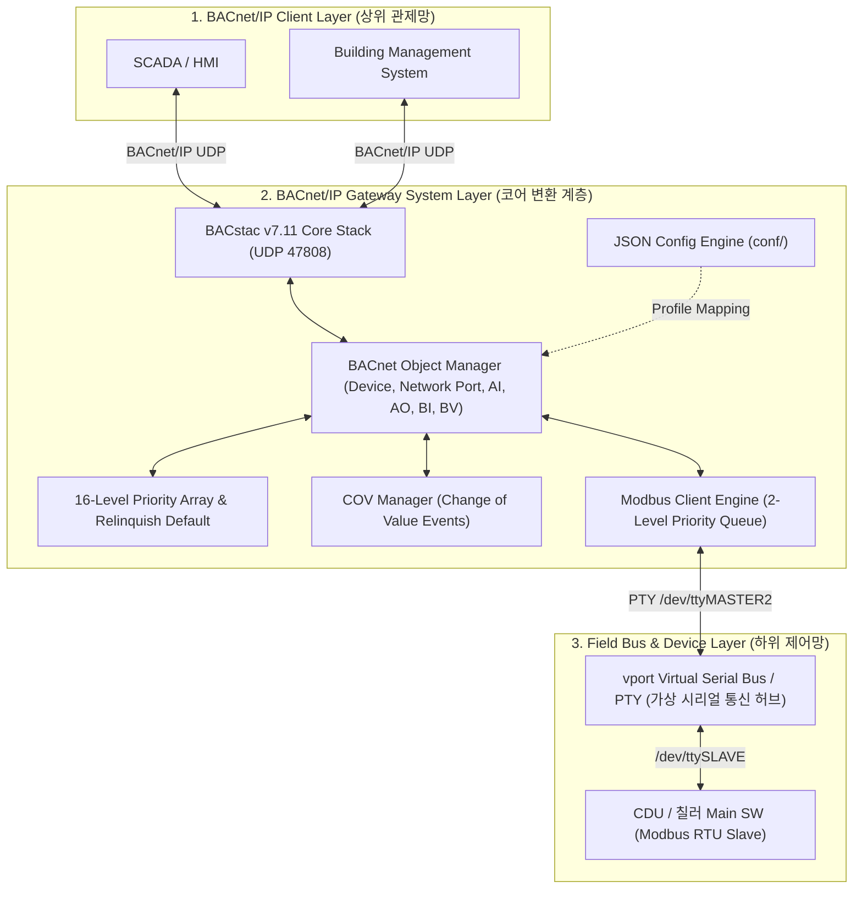
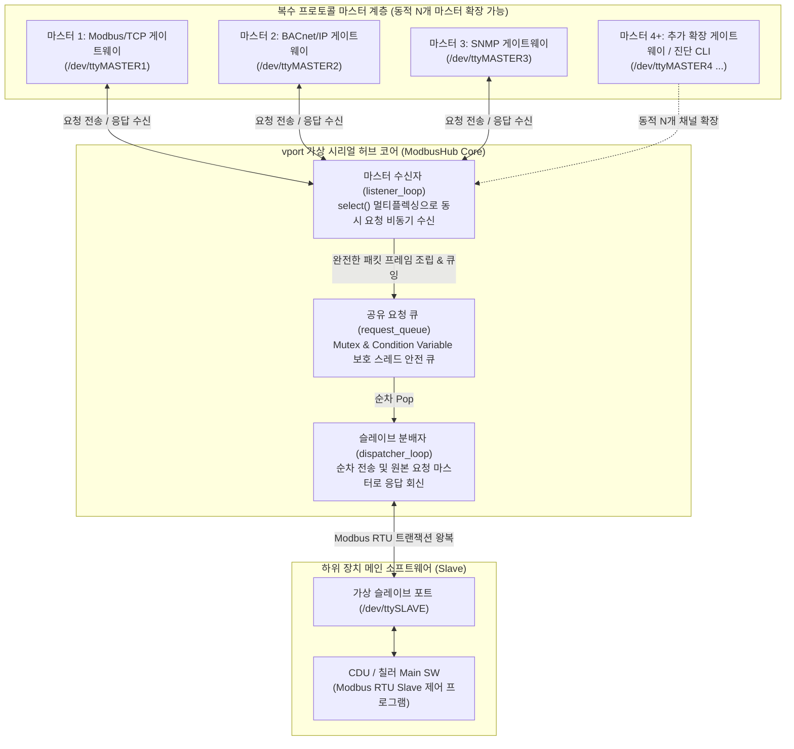
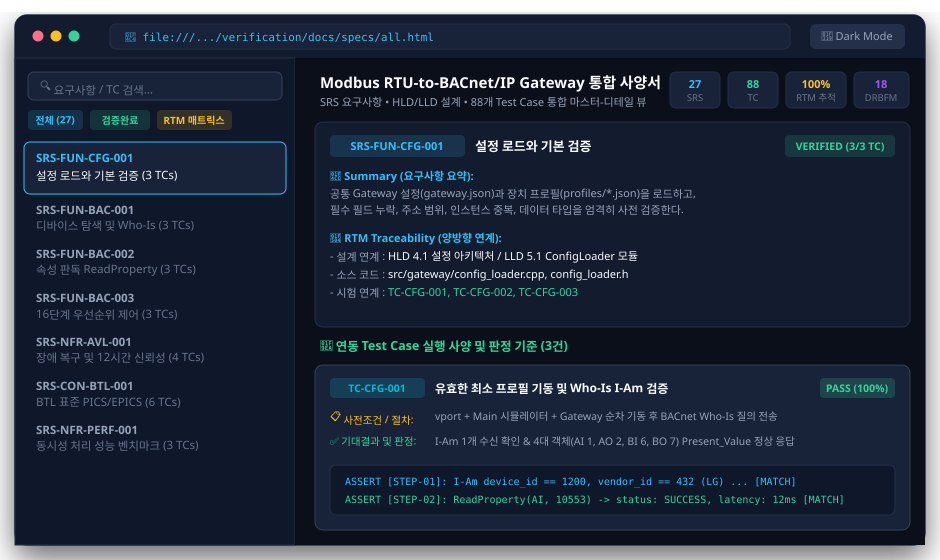
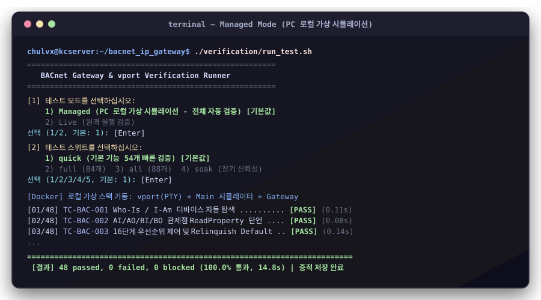
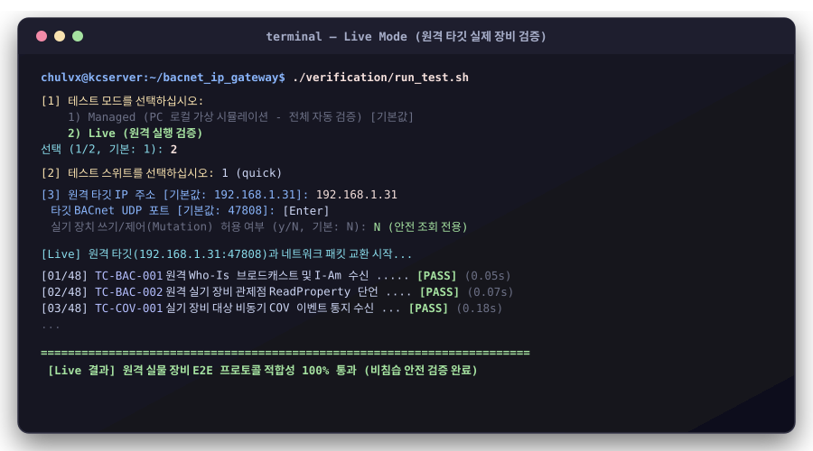
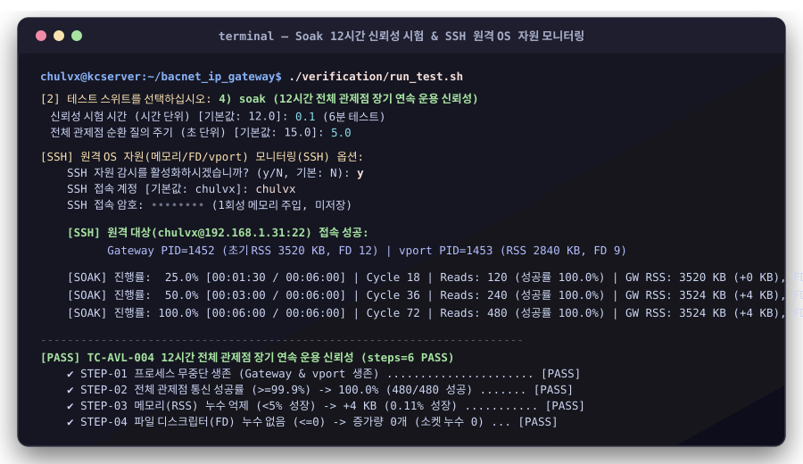
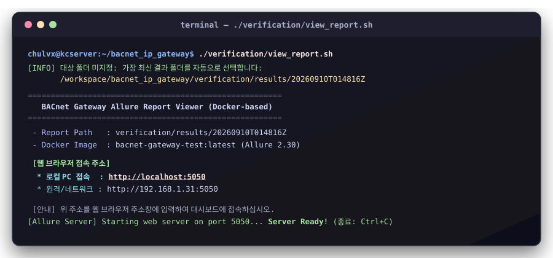
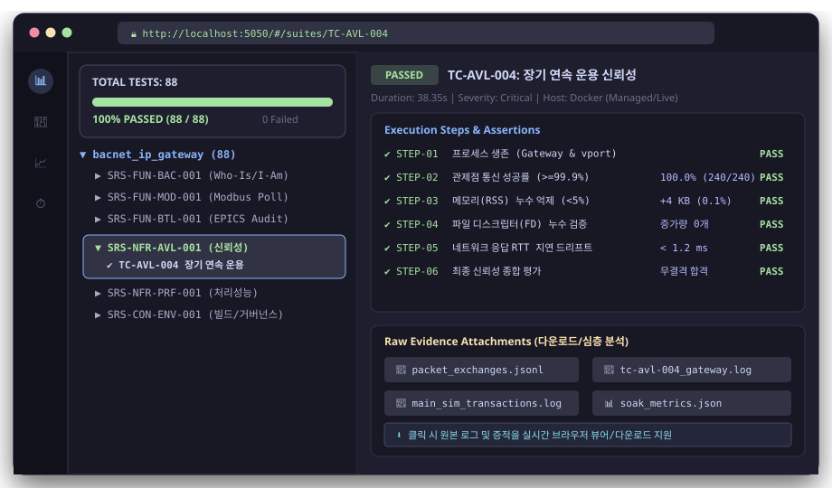

# BACnet/IP Gateway

산업용 BACnet/IP 및 Modbus 프로토콜을 상호 변환하고, 16단계 우선순위 제어, COV 실시간 알림, 자동 EPICS/TPI 추출 및 12시간 무중단 신뢰성을 보장하는 **고신뢰성 임베디드 BACnet Gateway 시스템**입니다.

---

## 🏛 1. 시스템 계층 구성 (System Architecture)

상위 BACnet 클라이언트(SCADA, BMS)와 하위 필드 장치(Modbus RTU/TCP 디바이스, 센서, 액추에이터 등) 사이에서 표준 BACnet 객체 인터페이스와 Modbus 레지스터 간의 실시간 양방향 매핑을 수행합니다.



---

## 💻 2. 소프트웨어(SW) 모듈 구성

게이트웨이는 C++17 기반의 고성능, 비동기 논블로킹 아키텍처로 구현되어 있으며 모듈별 책임이 명확히 분리되어 있습니다.

```text
bacnet_ip_gateway/
├── src/
│   ├── gateway/                   # 핵심 게이트웨이 로직
│   │   ├── bacnet_gateway.cpp/h   # BACstac C API 래퍼, 오브젝트 핸들러, 속성 읽기/쓰기
│   │   ├── modbus_client.cpp/h    # 2단계 우선순위 큐 기반 비동기 Modbus RTU 마스터 엔진
│   │   ├── cov_manager.cpp/h      # Change of Value 구독 관리 및 실시간 변경 통지 디스패처
│   │   ├── config_loader.cpp/h    # conf/ 디렉터리 JSON 파서 및 레지스터 매핑 캐시
│   │   ├── fd_monitor.cpp/h       # Foreign Device BBMD 등록 감시 및 주기적 재등록
│   │   ├── file_logger.cpp/h      # Tee 방식 콘솔/파일 동시 출력 및 크기 제한 순환 백업 로거
│   │   ├── tpi_exporter.cpp/h     # BTL 인증 제출용 EPICS/TPI 자동 생성기
│   │   └── main.cpp               # 시그널 핸들러, 라이프사이클 관리 및 메인 루프
│   └── common/                    # 공통 인프라스트럭처
│       ├── serial_port.cpp/h      # RS-485/UART 시리얼 포트 추상화
│       ├── inotify_port_watcher.h # 장치 노드 핫플러그(Hot-plug) 자동 감지 및 재연결
│       └── modbus_frame_builder.h # Modbus RTU 패킷 빌더 및 CRC-16 무결성 검증
├── conf/                          # 게이트웨이 통신 및 관제점 매핑 설정
│   ├── gateway.json               # BACnet Device 및 Modbus Serial 통신 기본 설정
│   └── profiles/                  # 장치별 관제점 매핑 프로파일 JSON 폴더
│       └── lg_cdu_c.json          # 예: LG CDU 장치 관제점 정의 (2,600+ 라인)
├── bip.cfg -> bip.cfg.normal     # BACnet/IP 통신 스택 설정 링크 (Network Port WriteProperty로 Normal/FD 런타임 전환 시 자동 재연결)
├── bip.cfg.normal / bip.cfg.fd    # Normal / Foreign Device 설정 파일 (Network Port WriteProperty로 BBMD IP/Port 및 TTL 실시간 갱신 가능)
└── verification/                  # V&V 엔지니어링 문서 및 Docker 기반 테스트 패키지
```

---

## ⚙️ 3. 기본 실행 및 프로파일(관제점) 설정

### 3.1 프로파일(관제점) 작성 및 적용

게이트웨이는 코드 수정 없이 `conf/` 디렉터리의 JSON 파일 작성만으로 신규 장치 및 관제점을 추가/변경할 수 있습니다.

#### ① 공통 게이트웨이 통신 설정 ([conf/gateway.json](conf/gateway.json))
BACnet 디바이스 속성과 하위 Modbus 시리얼 포트 파라미터를 정의합니다.
```json
{
  "bacnet": {
    "device_id": 1200,
    "device_name": "CDU_Gateway",
    "vendor_id": 432,
    "vendor_name": "LG Electronics",
    "model_name": "KSSU500CO20"
  },
  "modbus": {
    "serial_device": "/dev/ttyMASTER2",
    "serial_baudrate": 19200,
    "serial_data_bits": 8,
    "serial_parity": "none",
    "serial_stop_bits": 1,
    "rtu_timeout_ms": 500,
    "cov_polling": 0.5
  }
}
```

#### ② 장치별 관제점 매핑 프로파일 ([conf/profiles/](conf/profiles/))
Modbus 슬레이브 Unit ID와 매핑할 BACnet 객체(AI, AO, BI, BV) 목록을 기술합니다.
```json
{
  "modbus_unit_id": 1,
  "objects": [
    {
      "name": "Cooling_Water_Inlet_Temp",
      "modbus_block": "INPUT_REGISTER",
      "full_address": 30001,
      "instance": 1
    },
    {
      "name": "Chiller_Run_Command",
      "modbus_block": "COIL",
      "full_address": 1,
      "instance": 101
    }
  ]
}
```
* **블록 매핑**:
  - `DISCRETE_INPUT` $\rightarrow$ Binary Input (BI)
  - `COIL` $\rightarrow$ Binary Value (BV, 16단계 우선순위 제어 지원)
  - `INPUT_REGISTER` $\rightarrow$ Analog Input (AI)
  - `HOLDING_REGISTER` $\rightarrow$ Analog Output (AO, 16단계 우선순위 제어 지원) 또는 Analog Input (AI, read_only 시)
* **적용**: `conf/profiles/` 경로에 `.json` 파일을 저장하면 게이트웨이 실행 시 자동으로 읽어 BACnet 주소 공간을 구성합니다.

> [!TIP]
> **상세 설정 가이드 및 파라미터 레퍼런스:**  
> Scale/Offset 단위 변환, Min/Max 범위 제한, Byte/Word Swap, Bit 마스킹 및 Relinquish Default 등 관제점 매핑에 관한 전체 파라미터 명세와 실무 작성 예시는 **[doc/device_config_guide.md](doc/device_config_guide.md)**를 참고하십시오.

---

### 3.2 vport 및 게이트웨이 실행 방법

실제 RS-485 하드웨어가 없는 개발 PC 환경에서는 가상 시리얼 통신 허브 프로그램인 **`vport`**를 실행하여 Modbus 통신 루프백 및 멀티 마스터 다중화 환경을 구성합니다.

`vport`는 리눅스 가상 터미널(PTY)을 활용하여 물리적인 결선 없이 **복수의 프로토콜 변환 마스터(Modbus/TCP, BACnet/IP, SNMP)가 단일 CDU/칠러 Main SW의 Modbus RTU 포트에 충돌 없이 동시 접근**할 수 있도록 요청을 큐잉하고 중재하는 소프트웨어 허브입니다.



#### Step 1. 가상 시리얼 포트 허브 (`vport`) 실행
가상 PTY 포트 쌍(`/dev/ttyMASTER1~N` $\leftrightarrow$ `/dev/ttySLAVE`)을 생성합니다.
```bash
# vport 실행 (인자값으로 마스터 채널 수 지정, 예: 3개 또는 4개 이상 동적 생성)
../vport_release/vport 3 --link-dir /dev
```

#### Step 2. 게이트웨이 구동 (`bacnet_ip_gateway`)
설정 디렉터리를 인자로 지정하여 게이트웨이 데몬을 실행합니다.
```bash
# 기본 conf 폴더를 사용하여 게이트웨이 시작
./bacnet_ip_gateway ./conf
```
* 실행 로그에서 설정된 관제점 개수, Modbus 포트 바인딩, BACnet UDP 47808 바인딩을 확인할 수 있습니다.
* **바인딩 인터페이스 지정 (`bip.cfg` / `bip.cfg.fd`의 `iface=<이름>`)**: 네트워크 인터페이스가 2개 이상이면 `iface=eth0`처럼 지정합니다. 지정하면 `ip=`보다 우선하고, 그 인터페이스의 현재 IPv4와 실제 netmask로 바인딩합니다. 다른 인터페이스로는 넘어가지 않습니다.
  * 링크 DOWN→UP(같은 IPv4): 재시작 없이 자동 복구합니다(`[Net] Link down` / `[Net] Link up`).
  * 운용 중 IPv4 변경: `[Net] IPv4 changed <old> -> <new>` 후 자체 재시작으로 새 IPv4에 다시 바인딩합니다.
  * 기동 시 IPv4 없음(링크 다운, DHCP 지연): 종료하지 않고 `[Main] Waiting for network ...`를 남기며 대기합니다.
  * FD 모드: 링크가 복구되면 즉시 BBMD에 재등록합니다.
* **로그 파일**: 콘솔(stdout/stderr) 출력은 기본적으로 `/var/log/bacnet_ip_gateway.log` 에도 함께 기록됩니다.
  * 각 줄 앞에 `YYYY-MM-DD HH:MM:SS.mmm I|E` (I: stdout, E: stderr) 시각/구분이 붙습니다.
  * 크기 제한: 현재 파일이 한도의 절반을 넘으면 `bacnet_ip_gateway.log.1` 로 교체하고 새 파일에 기록하여, 두 파일 합계가 한도 이하로 유지되고 최신 내용이 보존됩니다.
  * Network Port 설정 변경에 따른 자체 재시작(execv) 후에도 같은 파일에 이어서 기록됩니다.
  * BACstac 라이브러리 자체 메시지(`bip: ... bound to` 등)는 syslog(`/var/log/messages`)에 기록됩니다.
  * 오류·이상 상황(Modbus timeout/응답 검증 실패, 시리얼 포트 오류, `[Modbus Queue Full]`, `[Modbus Worker] Job Timed Out`, `[Modbus Error] Write failed`, `ReadProperty Error: Modbus read failed for '<객체명>'`)은 `BACNET_LOG` 설정과 무관하게 항상 stderr(`E`)로 기록됩니다. `BACNET_LOG=1` 은 정상 송수신/프레임 추적 로그만 추가합니다.

  | 환경 변수 | 기본값 | 설명 |
  |---|---|---|
  | `BACNET_LOG` | (미설정) | `1` 이면 BACnet/Modbus 송수신 상세 로그 출력 |
  | `BACNET_LOG_FILE` | `/var/log/bacnet_ip_gateway.log` | 로그 파일 경로. 빈 문자열 또는 `none` 이면 파일 로그 비활성화 |
  | `BACNET_LOG_MAX_KB` | `1024` | 로그 파일 총 크기 한도(KB, 현재 파일 + `.1`). 최소 32 |

  ```bash
  # 상세 로그를 켜고 로그 파일 한도를 4MB 로 지정하여 실행
  BACNET_LOG=1 BACNET_LOG_MAX_KB=4096 ./bacnet_ip_gateway ./conf
  ```
  파일을 열 수 없으면(권한 없음 등) `[Log] File logging disabled ...` 경고를 출력하고 콘솔 전용으로 계속 동작합니다.

#### Step 3. 통신 동작 확인
상위 BACnet 클라이언트 도구(예: `bacpypes3`, Yabe, BACnet Scan 등)를 통해 Who-Is 및 관제점 ReadProperty 조회가 가능합니다.

---

## 📚 4. V&V 엔지니어링 문서 체계 ([verification/docs/](verification/docs/))

본 프로젝트는 고신뢰성 임베디드 소프트웨어 표준에 준하는 **V-모델 기반 V&V(Verification & Validation) 엔지니어링 문서 체계**를 완비하고 있습니다.

### 🌐 대화형 단일 사양 뷰어 ([specs/all.html](verification/docs/specs/all.html))
프로젝트의 모든 요구사항과 설계를 웹 브라우저에서 인터랙티브하게 열람할 수 있는 통합 사양 뷰어입니다.
* **주요 기능**:
  - 실시간 요구사항 키워드 검색 및 상태 필터링
  - 28개 SRS 요구사항 ↔ HLD/LLD 설계 ↔ 94개 TC ↔ 소스코드 **100% 양방향 추적 연계 내장**
  - BTL 테스트 체크리스트 카드 제공
  - 다크/라이트 테마 원클릭 전환

<p align="center">
  <a href="verification/docs/specs/all.html">
    
  </a>
  <br>
  <em>▲ 브라우저에서 열람 가능한 all.html 대화형 통합 사양서 뷰어 (클릭 시 all.html 이동)</em>
</p>

### 🏛 공식 심사 및 제출 사양서 ([specs/](verification/docs/specs/))
| 구분 | 문서 파일명 | 문서 식별자 | 주요 내용 및 목적 |
| :--- | :--- | :--- | :--- |
| **SRS** | [bacnet_ip_gateway_srs.docx](verification/docs/specs/bacnet_ip_gateway_srs.docx) | `SRS-BIG-001` | **소프트웨어 요구사항 명세서** (ISO/IEC/IEEE 29148 기준 28개 원자 요구사항) |
| **HLD** | [bacnet_ip_gateway_hld.docx](verification/docs/specs/bacnet_ip_gateway_hld.docx) | `HLD-BIG-001` | **상위/기본설계서** (3계층 격리, 프로세스 상태 머신, 시퀀스) |
| **LLD** | [bacnet_ip_gateway_lld.docx](verification/docs/specs/bacnet_ip_gateway_lld.docx) | `LLD-BIG-001` | **하위/상세설계서** (11개 C++ 모듈, 2단계 큐 알고리즘, 세부 구조체) |
| **TC Spec** | [bacnet_gateway_test_spec.md](verification/docs/specs/bacnet_gateway_test_spec.md) | `TCS-BIG-001` | **테스트 케이스 명세서** (94개 TC별 사전조건, 패킷 교환 절차, 기대값) |

### 🛠 실무 환경 및 운영 가이드
| 문서 파일명 | 주요 내용 |
| :--- | :--- |
| [doc/device_config_guide.md](doc/device_config_guide.md) | **기기별 JSON 설정 파일 작성 가이드** (관제점 매핑, 타입 변환, Min/Max 제한, Relinquish Default 상세 명세) |
| [test_environment_portability_plan.md](verification/docs/guides/test_environment_portability_plan.md) | **포터블 테스트 환경 가이드** (Docker 컨테이너 격리, `test_config.json` 3단 계층 설정, 모드별 실행 옵션) |
| [README_benchmark.md](verification/docs/guides/README_benchmark.md) | **성능 벤치마크 가이드** (Throughput, Latency 측정 방식, BTL 전수 검증 방법론) |

---

## 🧪 5. 자동 검증 및 심층 증적 확인 (Verification & Testing)

본 프로젝트는 의존성 설치 없이 실행 가능한 **Docker 기반 원클릭 자동 검증 시스템**과 **Allure 기반 웹 브라우저 증적 뷰어**를 내장하고 있습니다.

---

### 5.1 Managed 모드: PC 로컬 가상 시뮬레이션 (전체 자동 검증) [기본값]

* **개념 및 특징**:
  - 실물 하드웨어나 RS-485 배선이 없는 개발 PC 환경에서도 **94개 전체 TC를 100% 자동 검증**합니다.
  - Docker 컨테이너가 `vport`(가상 PTY 시리얼 버스), `modbus_rtu_slave.py`(Main 시뮬레이터), `bacnet_ip_gateway`를 백그라운드 프로세스로 직접 기동하고 라이프사이클을 관리합니다.
  - **결함 주입 (Fault Injection) 완전 지원**: 시뮬레이터 강제 지연, CRC 오류 주입, 프로세스 강제 종료/재기동 복구 등 침습적 한계 시험을 안전하게 자동 수행합니다.
* **실행 방법**:
  ```bash
  # 대화형 프롬프트에서 1) Managed 선택 (기본값)
  ./verification/run_test.sh

  # 또는 CLI 직접 실행 (기본 48개 빠른 검증)
  ./verification/run_test.sh --suite quick --mode managed
  ```

<p align="center">
  
  <br>
  <em>▲ Managed 모드 실행: 로컬 가상 스택 자동 기동 및 48개 TC 100% 통과 콘솔 화면</em>
</p>

---

### 5.2 Live 모드: 원격 실행 검증 (실제 타깃 보드/장치 프로토콜 검증)

* **개념 및 특징**:
  - 네트워크(IP)로 연결된 **실제 원격 타깃(임베디드 보드, 리눅스 서버 등)**에서 이미 동작 중인 실물 게이트웨이 및 필드 장치를 대상으로 E2E 프로토콜 적합성을 검증합니다.
  - 러너가 원격 프로세스를 강제 종료하지 않는 **비침습(Non-invasive) 방식**으로 동작하며, 실기 장비 보호를 위해 기본적으로 **안전 조회 모드(Read-only)**로 보호됩니다 (제어/쓰기는 명시적 허용 시에만 수행).
* **실행 방법**:
  ```bash
  # 대화형 프롬프트에서 2) Live 선택 후 타깃 IP 입력
  ./verification/run_test.sh

  # 또는 CLI 직접 실행
  ./verification/run_test.sh --suite quick --mode live --ip 192.168.1.31 --port 47808
  ```

<p align="center">
  
  <br>
  <em>▲ Live 모드 실행: 원격 타깃(192.168.1.31) 대상 비침습 프로토콜 검증 화면</em>
</p>

---

### 5.3 장기 연속 운용 신뢰성 시험 (`soak`, TC-AVL-004) 및 SSH 원격 자원 감시

단시간 기능 검증으로는 발견하기 어려운 **메모리 누수(Memory Leak), 파일 디스크립터(FD) 누수, 타이머 오버플로우**를 검출하기 위한 전용 신뢰성 시험입니다.

* **신뢰성 시험 개요 (`soak`)**:
  - 기본 **12시간**(테스트 옵션으로 수 분~수 시간으로 단축/연장 가능) 동안 등록된 전 관제점을 15초 주기로 끊임없이 순환 질의합니다.
  - **합격 기준**: 프로세스 무중단 생존, 통신 성공률 $\ge 99.9\%$, 메모리 증가율 < 5% 또는 < 2MB 억제, FD(소켓) 증가량 $\le 0$개.
* **원격 타깃 SSH 자원 실시간 감시 옵션**:
  - Live 모드에서 신뢰성 시험 수행 시, 원격 장치에 별도 에이전트를 설치하지 않고 **OpenSSH를 통해 원격 타깃의 내부 OS 자원을 실시간으로 직접 추적**합니다.
    - **프로세스 생존**: Gateway 및 vport PID 추적
    - **물리 메모리(RSS) 누수**: `/proc/<PID>/status`의 `VmRSS` 변화율 추적
    - **파일 디스크립터(FD) 누수**: `/proc/<PID>/fd/` 열린 핸들 개수 추적
  - **인증 방식**: `~/.ssh` 키 기반 무암호 인증 및 1회성 프롬프트 암호 입력(`SSH_PASS`, 설정 파일 미저장) 지원
  - **SSH 비활성화(`N`) 시 동작**: SSH 없이도 BACnet 네트워크 응답 왕복 지연시간(RTT 드리프트 < 50ms) 및 타임아웃 0건 기준으로 안정성을 안전하게 대체 평가합니다.
* **실행 방법**:
  ```bash
  # 대화형 프롬프트에서 스위트 4) soak 선택 (시험 시간, 질의 주기, SSH 감시 옵션 입력)
  ./verification/run_test.sh

  # 또는 CLI 직접 실행 (예: 1시간 soak 테스트)
  ./verification/run_test.sh --suite soak --mode live --ip 192.168.1.31 --soak --soak-hours 1.0 --ssh-enable --ssh-user chulvx
  ```

<p align="center">
  
  <br>
  <em>▲ 장기 신뢰성 시험 실행: SSH 접속 성공 후 실시간 메모리/FD 추적 및 무누수 합격 로그</em>
</p>

---

### 5.4 Allure 리포트 서버 구동 (`view_report.sh`)
테스트 완료 후 최신 증적 데이터를 웹 서버로 띄워 인터랙티브하게 확인합니다.
```bash
# 최신 테스트 결과 폴더 자동 서빙 (기본 포트: 5050)
./verification/view_report.sh
```

<p align="center">
  
</p>

---

### 5.5 웹 브라우저 심층 증적 뷰어 (Allure Dashboard)
웹 브라우저에서 `http://localhost:5050`에 접속하면, 94개 TC의 세부 실행 결과와 증적을 정밀 분석할 수 있습니다.
* **주요 확인 항목**:
  - **스텝별 Assertion**: 각 TC의 STEP별 기대값(Expected)과 수신값(Actual) 일치 여부
  - **실시간 패킷 로그 (`packet_exchanges.jsonl`)**: 전송/수신된 모든 BACnet/Modbus 바이트 단위 패킷 트랜잭션
  - **프로세스 및 OS 자원 메트릭**: 게이트웨이 및 vport의 물리 메모리(RSS) 및 파일 디스크립터(FD) 누수 추이

<p align="center">
  
</p>

---

### 5.6 테스트 스위트 구분 (94개 전수 TC)
| 스위트 명 | TC 개수 | 설명 |
| :--- | :---: | :--- |
| **quick** | 54개 | 핵심 BACnet/IP 통신, 읽기/쓰기, 우선순위, COV 기본 기능 신속 검증 (약 15초 소요) |
| **full** | 90개 | BTL 전수 적합성, 다중 디바이스 부하, 응답 지연시간(RTT), 네트워크 장애 복구(`TC-NET-*`, root 컨테이너) 정밀 검증 |
| **all** | 94개 | 전체 기능/성능 TC 및 빌드 거버넌스(`TC-ENV-001`), 정적 감사(`audit`) 포함 |
| **soak** | 1개 | **TC-AVL-004**: 12시간 전체 관제점 순환 질의 장기 연속 운용 신뢰성 및 메모리/FD 누수 검증 |

---

## 👤 Maintainer & Contact

* **조직**: 데이터센터제어솔루션TDR
* **담당자**: 이계철 책임
* **이메일**: [kyechul.lee@lge.com](mailto:kyechul.lee@lge.com)
