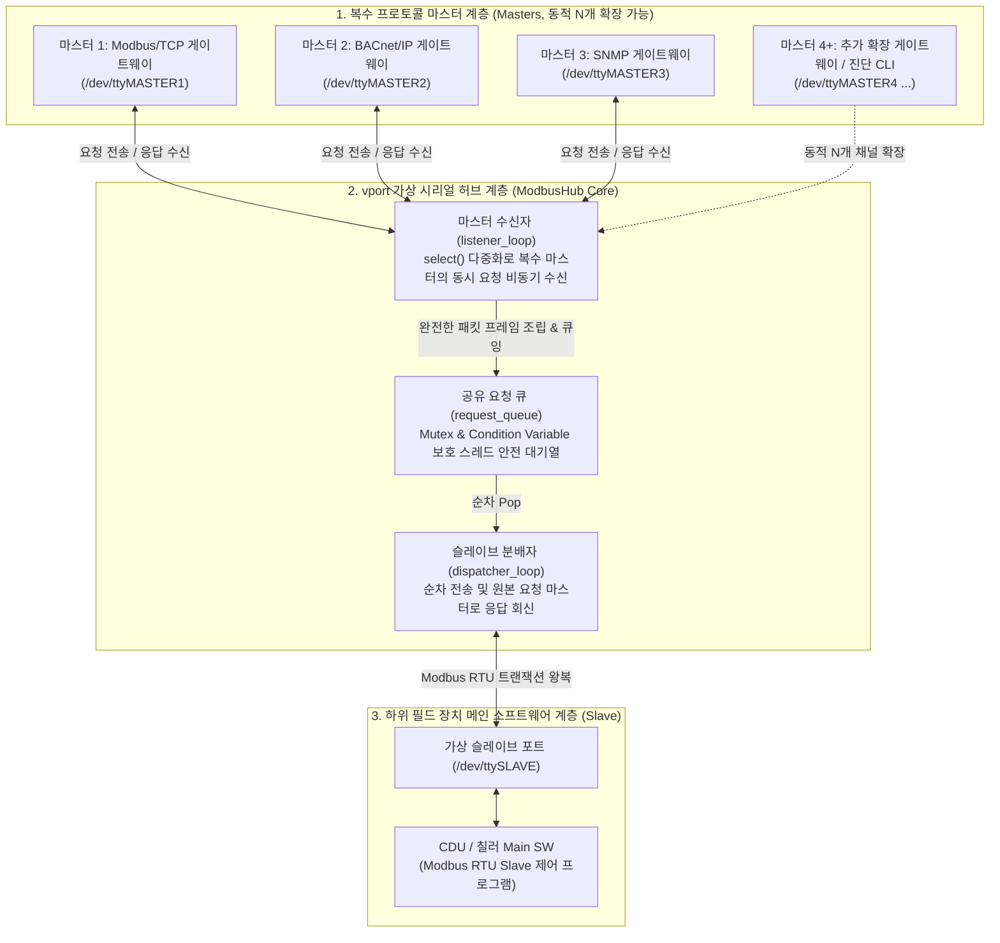

# VPORT - ModbusRTU Multi-Master Hub

리눅스 가상 터미널(PTY, Pseudo-Terminal)을 활용하여 물리적인 결선 없이 **복수의 Modbus RTU Master가 단일 Modbus RTU Slave(CDU, 칠러 메인 SW 등)에 충돌 없이 동시 접근**할 수 있도록 요청을 큐잉하고 중재하는 **고신뢰성 가상 시리얼 통신 허브 시스템**입니다.

---

## 🏛 1. 시스템 계층 아키텍처 (System Architecture)

상위 프로토콜 변환 게이트웨이 및 진단 도구들과 하위 필드 장치 제어 프로그램 사이에서 1:N 시리얼 통신 프레임의 멀티플렉싱(Multiplexing)과 동기화(Synchronization)를 수행합니다.



---

## 💻 2. 소프트웨어(SW) 모듈 구성

C++11 기반의 경량화된 고성능 아키텍처로 구현되어 있으며, 자원 누수 방지와 단위 테스트 격리성이 보장되어 있습니다.

```text
vport_release/
├── inc/
│   └── vport.h             # RAII UniqueFd, ISerialPort 인터페이스 및 ModbusHub 클래스 선언
├── src/
│   ├── vport.cpp           # 가상 PTY 링크 생성, 프레임 파싱 및 허브 코어 로직 구현
│   ├── vport_main.cpp      # 프로그램 진입점, 인자 파싱 및 서비스 데몬 실행부
│   └── vport_test.cpp      # SocketPair 및 Mock 기반 E2E 단위 테스트 스위트
├── doc/
│   ├── vport_release_note.md          # 세부 아키텍처 사양 및 연동 기술 문서
│   └── vport_design_diagram_v1.0.jpg  # 허브 코어 스레드 흐름 설계 다이어그램
├── vport.cfg               # 슬레이브 응답 타임아웃 환경 설정 파일
├── Makefile                # x86 호스트 및 크로스 컴파일 빌드 스크립트
└── makeIMX                 # i.MX(ARM) Yocto SDK 환경 툴체인 빌드 스크립트
```

---

## ⚙️ 3. 주요 기술적 특징 (Key Technical Features)

### 3.1. 생성자-소비자(Producer-Consumer) 2스레드 파이프라인
* **마스터 수신자 (`listener_loop`)**: POSIX `select()` 시스템 콜을 활용하여 등록된 모든 가상 마스터 포트(`/dev/ttyMASTER1~N`)의 수신 이벤트를 단일 스레드로 비동기 감시합니다.
* **스레드 안전 요청 큐 (`request_queue_`)**: 수신된 패킷의 원본 마스터 인덱스(Origin Index)를 태깅하여 뮤텍스(`std::mutex`)와 조건 변수(`std::condition_variable`)로 보호되는 큐에 적재합니다.
* **슬레이브 분배자 (`dispatcher_loop`)**: 큐에서 요청을 순차적으로 꺼내 슬레이브 포트(`/dev/ttySLAVE`)로 전송한 후, 슬레이브 응답이 도착하면 해당 요청을 보냈던 원본 마스터 포트로 회신합니다.

### 3.2. 리눅스 가상 PTY(Pseudo-Terminal) 에뮬레이션
* 물리적인 RS-485 배선이나 하드웨어 변환기 없이, 시스템 내부에 PTY 장치 쌍을 열고 지정된 위치에 심볼릭 링크(`symlink`)를 자동 생성합니다.
* 마스터 및 슬레이브 프로그램은 표준 POSIX 시리얼 장치 파일(예: `/dev/ttyMASTER1`, `/dev/ttySLAVE`)을 직접 열어 실제 하드웨어 COM 포트와 동일한 방식으로 통신합니다.

### 3.3. RAII 기반 자원 안전성 (`UniqueFd`)
* 파일 디스크립터(FD)를 객체의 수명 주기와 일치시키는 `UniqueFd` 래퍼를 적용하여, 비정상 종료(Crash)나 시그널 수신 시 열려 있는 포트 자원과 심볼릭 링크를 누수 없이 자동으로 정리합니다.

### 3.4. 패킷 단편화 방지 및 재조립(Reassembly) 엔진
* 시리얼 버스에서 발생할 수 있는 데이터 단편화(Fragmentation)에 대응하여, 완전한 Modbus RTU 프레임 크기를 수신할 때까지 버퍼링하고 CRC-16 오류 검증을 거친 완전한 프레임만 큐에 이관합니다.

### 3.5. 비표준 6바이트 단축 응답 자동 감지
* 파나소닉 모터 등 일부 기기에서 Modbus FC06(Write Single Register) 명령에 대해 데이터 영역 없이 6바이트로 응답하는 비표준 통신 방식을 자동으로 감지하여 예외 없이 처리합니다.

---

## 🚀 4. 기본 실행 및 설정 방법 (Quick Start)

### 4.1. 환경 설정 파일 ([`vport.cfg`](vport.cfg))
슬레이브 포트로부터의 응답 대기 타임아웃을 밀리초(ms) 단위로 지정합니다.
```ini
# ModbusRTU Multi-Master Hub Configuration File
# Slave Response Timeout in Milliseconds
DEFAULT_SLAVE_TIMEOUT_MS=500
```

### 4.2. 실행 명령어 (CLI)
인자로 생성할 가상 마스터 채널 수를 지정하여 실행합니다.

```bash
# 기본 3개 마스터 채널 생성 (/dev/ttyMASTER1, /dev/ttyMASTER2, /dev/ttyMASTER3 <-> /dev/ttySLAVE)
./vport 3

# 동적 채널 확장 (예: 4개 마스터 채널 생성)
./vport 4

# 격리 환경 실행 (링크 경로 및 설정 파일 사용자 지정)
./vport 3 --link-dir ./dev --config ./vport.cfg
```

* **옵션 안내**:
  - `[마스터수]`: 생성할 마스터 포트 개수 (생략 시 기본 3개)
  - `--link-dir <디렉터리>`: 심볼릭 링크를 생성할 경로 (기본값: `/dev`)
  - `--config <파일>`: 환경 설정 파일 경로 (기본값: `./vport.cfg`)

---

## 🛠 5. 빌드 및 테스트 (Build & Test)

### 5.1. 호스트 PC 빌드 (x86_64)
```bash
# 전체 빌드
make clean
make

# 단위 테스트 실행 (Unix domain socketpair 기반 비동기 통합 검증)
make test
```
* **출력 바이너리**: `vport` (데몬 실행 파일), `vport_test` (통합 테스트 실행 파일)

### 5.2. i.MX(ARM) 크로스 컴파일
타깃 임베디드 보드용 컴파일 시 Yocto SDK 환경 스크립트를 로드하여 빌드합니다.
```bash
./makeIMX clean
./makeIMX
```
* `Makefile` 내부에서 컴파일러 명칭의 `arm` 문자열을 자동으로 식별하여 최적화된 ARM 32비트 바이너리를 생성합니다.

---

## 📚 6. 엔지니어링 문서 체계 (Documentation)

* **[doc/vport_release_note.md](doc/vport_release_note.md)**: vport 구현 상세, 클래스 다이어그램 및 프레임 핸들링 사양서
* **[doc/vport_design_diagram_v1.0.jpg](doc/vport_design_diagram_v1.0.jpg)**: 멀티 마스터 허브 스레드 흐름 및 인터페이스 설계도

---

## 👤 Maintainer & Contact

* **조직**: 데이터센터제어솔루션TDR
* **담당자**: 이계철 책임
* **이메일**: [kyechul.lee@lge.com](mailto:kyechul.lee@lge.com)
