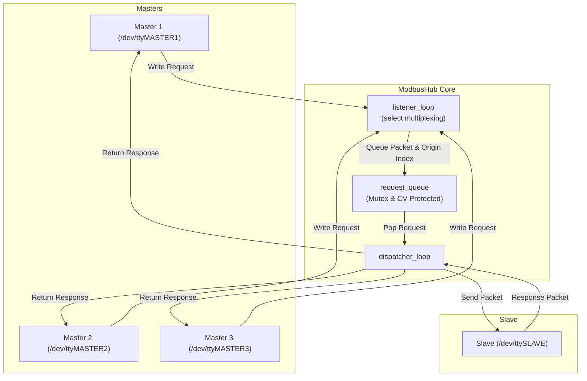

# VPORT - ModbusRTU Multi-Master Hub

본 프로그램은 하나의 ModbusRTU Slave 장치를 복수의 ModbusRTU Master와 연결할 수 있는 기능을 제공합니다.
기술적으로는 리눅스의 Virtual PTY(Pseudo-Terminal, 가상 터미널)를 이용하여 물리적인 하드웨어 장치나 RS485선 연결 없이, 소프트웨어적으로 1:N 통신 허브 역할을 수행합니다.

## 1. 디렉토리 구조 및 주요 파일 설명

### 디렉토리 구조

```
vport/
├── [doc](file:///doc)/
│   └── [vport.md](file:///doc/vport.md)             # 프로젝트 설명 및 아키텍처 문서 (본 파일)
├── [inc](file:///inc)/
│   └── [vport.h](file:///inc/vport.h)              # 클래스 및 인터페이스 선언, 설정 상수 정의
├── [src](file:///src)/
│   ├── [vport.cpp](file:///src/vport.cpp)          # 가상 PTY 생성, 프레임 파싱 및 허브 코어 로직 구현
│   ├── [vport_main.cpp](file:///src/vport_main.cpp)    # 프로그램 진입점 및 서비스 실행부
│   └── [vport_test.cpp](file:///src/vport_test.cpp)    # Mock 및 SocketPair 기반 E2E 단위 테스트
├── [vport.cfg](file:///vport.cfg)               # 프로그램 설정 파일 (슬레이브 타임아웃 등 설정)
└── [Makefile](file:///Makefile)                 # 빌드 및 테스트 자동화 스크립트
```

### 주요 파일 설명

- **[vport.cfg](file:///vport.cfg)**
  - 프로그램 동작 방식을 결정하는 주요 환경 설정 파일입니다.
  - 슬레이브 포트로부터의 응답 대기 타임아웃 시간(`DEFAULT_SLAVE_TIMEOUT_MS`) 등을 밀리초(ms) 단위로 지정할 수 있습니다.

- **[vport.h](file:///inc/vport.h)**
  - 가상 시리얼 허브에 필요한 주요 자료구조와 추상 인터페이스를 선언합니다.
  - 파일 디스크립터 누수 방지를 위한 RAII 래퍼 [UniqueFd](file:///inc/vport.h#L21-L42), 시리얼 포트 다형성을 위한 [ISerialPort](file:///inc/vport.h#L45-L52) 인터페이스 및 1:N 허브를 총괄하는 [ModbusHub](file:///inc/vport.h#L85-L112) 클래스가 정의되어 있습니다.

- **[vport.cpp](file:///src/vport.cpp)**
  - [create_pty_link](file:///src/vport.cpp#L85-L103) 함수를 통해 리눅스 PTY 장치를 열고 지정된 경로에 심볼릭 링크를 생성하여 가상 터미널 환경을 구축합니다.
  - [ModbusFramingParser](file:///inc/vport.h#L72-L76) 클래스를 통해 수신 버퍼 내에서 완전한 Modbus RTU 패킷(CRC16 검증 포함)을 추출합니다.
  - [ModbusHub](file:///inc/vport.h#L85-L112) 클래스의 멀티스레드 실행 루프([listener_loop](file:///src/vport.cpp#L269-L306), [dispatcher_loop](file:///src/vport.cpp#L308-L385))를 구현하여 마스터와 슬레이브 간의 메시지 흐름을 동기화합니다.

- **[vport_main.cpp](file:///src/vport_main.cpp)**
  - 인자값에 따라 마스터 가상 포트를 동적 개수(인자 생략 시 기본 3개)만큼 생성하고, 슬레이브 가상 포트 1개(`/dev/ttySLAVE`)를 생성하여 [ModbusHub](file:///inc/vport.h#L85-L112)를 가동하는 프로그램 진입점입니다.
  - 기존 `./vport [마스터수]` 실행법은 그대로 유지합니다. 시험 격리가
    필요한 경우 `--link-dir <디렉터리>`로 PTY 링크 위치를, `--config
    <파일>`로 설정 파일을 지정할 수 있습니다.

```bash
./vport 3 --link-dir <work-dir>/dev --config <work-dir>/vport.cfg
```

- **[vport_test.cpp](file:///src/vport_test.cpp)**
  - 물리 시리얼 연결 없이 로직을 검증할 수 있는 [MockSerialPort](file:///src/vport_test.cpp#L10-L59) 구현체와, Unix domain socketpair를 이용해 실제 멀티스레딩 비동기 통신 및 패킷 단편화(Fragmentation) 처리를 실시간으로 테스트할 수 있는 [SocketPairPort](file:///src/vport_test.cpp#L62-L107) 기반 통합 테스트 환경을 제공합니다.

- **[Makefile](file:///Makefile)**
  - `make` 및 `make test` 등의 빌드 타겟을 제공하며, x86_64 외에도 arm, mipsel 등의 크로스 컴파일 환경 빌드를 지원합니다.

---

## 2. 주요 아키텍처 및 기술적 특징

### 주요 아키텍처

`vport`는 크게 **마스터 수신자(Master Listener)**, **공유 요청 큐(Shared Request Queue)**, **슬레이브 분배자(Slave Dispatcher)**의 3계층 구조로 설계되어 있습니다.



- **생성자-소비자(Producer-Consumer) 패턴**:
  - **[listener_loop](file:///src/vport.cpp#L269-L306) (Producer)**: `select()` 시스템 콜을 활용해 등록된 모든 마스터 포트의 읽기 이벤트를 단일 스레드로 감시합니다. 데이터가 수신되면 버퍼에 조립 후, 완전한 프레임이 완성되면 `request_queue_`에 마스터 정보와 함께 푸시합니다.
  - **[dispatcher_loop](file:///src/vport.cpp#L308-L385) (Consumer)**: 조건 변수(Condition Variable)를 통해 대기하다가 큐에 요청이 들어오면 순차적으로 꺼내 슬레이브 포트에 전송합니다. 이후 슬레이브 포트로부터의 응답을 대기(타임아웃 적용)한 뒤 해당 요청을 발송했던 마스터 포트로 회신합니다.

### 기술적 특징

1. **리눅스 가상 PTY(Pseudo-Terminal) 에뮬레이션**
   - 하드웨어 및 케이블 결선 없이, 시스템 내부에 가상 터미널 기기 쌍을 개방하고 심볼릭 링크(`symlink`)를 생성하여 실제 시리얼 포트처럼 동작하게 만듭니다. 외부 Modbus Master/Slave 소프트웨어는 이 가상 장치 경로를 열어 마치 실제 COM 포트에 연동된 것처럼 작동할 수 있습니다.
2. **RAII 자원 안전성 ([UniqueFd](file:///inc/vport.h#L21-L42))**
   - 파일 디스크립터를 객체의 생명주기와 일치시키는 [UniqueFd](file:///inc/vport.h#L21-L42)를 사용하여, 프로세스 예외 상황이나 정상 종료 시 포트 자원 닫기(Close) 및 심볼릭 링크 정리가 누수 없이 자동 수행되도록 보장합니다.
3. **인터페이스 추상화를 통한 테스트 가능성 (Testability)**
   - [ISerialPort](file:///inc/vport.h#L45-L52) 추상 클래스를 두고 이를 구현하는 [PosixSerialPort](file:///inc/vport.h#L55-L66)와 [MockSerialPort](file:///src/vport_test.cpp#L10-L59), [SocketPairPort](file:///src/vport_test.cpp#L62-L107)를 설계하여, 물리 PTY에 직접 바인딩하지 않고도 독립된 단위/E2E 동기화 테스트를 구동할 수 있습니다.
4. **패킷 단편화 방지 및 재조립(Reassembly) 엔진**
   - 네트워크 혹은 시리얼 라인에서 발생할 수 있는 데이터 쪼개짐(단편화) 현상에 대응하여, 완전한 Modbus 패킷 프레임 크기를 수신하기 전까지 버퍼링하고 CRC16 오류 검증이 통과된 완전한 프레임만 처리 큐에 이관합니다.

---

## 3. Exception 대응

vport는 종료 없이 상시 구동하도록 설계되었습니다.
만약, Exception 등 예상하지 못한 이유로 재시작하는 경우에는 포트가 변경되므로 vport를 사용하는 프로그램들은 사용 중이던 포트를 Close하고, 다시 Open하여 사용해야 합니다.
각 프로그램별로 포트를 주기적으로 검사하는 방법을 사용하거나, 시스템에서 systemd를 사용하는 경우는 아래와 같이 의존관계를 정의하여 사용할 수 있습니다.

```ini
[Unit]
Description=Client Program
After=vport.service     # vport의 가상 링크 파일이 먼저 준비된 후 시작되도록 보장
BindsTo=vport.service   # vport가 비정상 종료(Crash, OOM 등) 시 함께 동반 종료 처리
PartOf=vport.service    # vport가 정상 재시작(restart) 시 함께 동반 재시작 처리
```

---

## 4. 6바이트 단축 응답 지원

파라소닉 모터 등 일부 기기의 경우 Modbus 06 Function에 대해서 데이터 영역 없이 아래와 같이 전체 6바이트로 응답하는 비표준 통신 방식을 사용하고 있습니다.
vport는 06 Function에 대한 Slave 응답이 6바이트로 오는 경우 동적으로 자동 감지하여 처리합니다.

```
>>> Request  (Rx): C8 06 A0 07 00 00 0B 92
    Set Run/Stop Motor : 0 (STOP)
<<< Response (Tx): C8 06 A0 07 E7 87
    Ack Set Run/Stop Motor
```

---

## 5. 빌드 및 i.MX(ARM) 크로스 컴파일 환경 구성

### 5.1. 호스트 PC 빌드 (x86_64)
호스트 환경에서 `vport` 바이너리 컴파일 및 테스트를 수행하는 방법은 다음과 같습니다:
```bash
make clean
make
make test
```
*   **출력 바이너리**: `vport` 및 `vport_test`

### 5.2. i.MX(ARM) 크로스 컴파일
[makeIMX](file:///makeIMX) 스크립트를 사용하여 Yocto SDK 툴체인을 로드하고 크로스 컴파일을 수행합니다.
```bash
./makeIMX clean
./makeIMX
```
*   **동작 구성**: `/opt/lg-headed/0.1/environment-setup-cortexa9hf-neon-poky-linux-gnueabi` 환경 스크립트를 실행하여 `CXX` 및 `SDKTARGETSYSROOT` 등의 변수를 자동으로 설정하고 `make`를 호출합니다.
*   **출력 바이너리**: `vport` (ELF 32-bit LSB executable, ARM 아키텍처)
*   **Makefile 아키텍처 감지**: [Makefile](file:///Makefile) 내부에서 컴파일러 명칭에 `arm` 문자열이 포함되어 있는지 자동으로 감지(`IS_ARM = $(findstring arm,$(CXX))$(findstring arm,$(CROSS))`)하여 타겟 아키텍처(`TARGET_ARCH = arm`)를 식별하여 빌드합니다.

